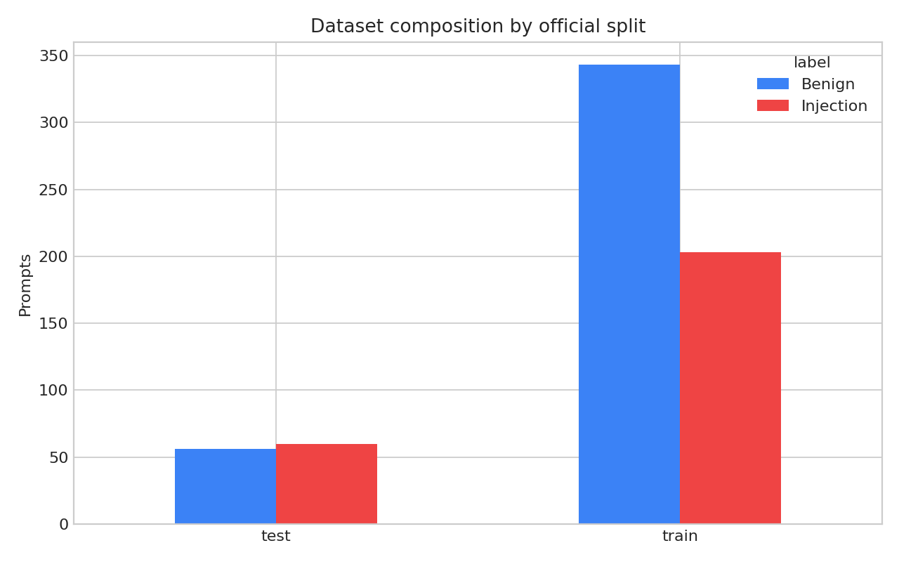
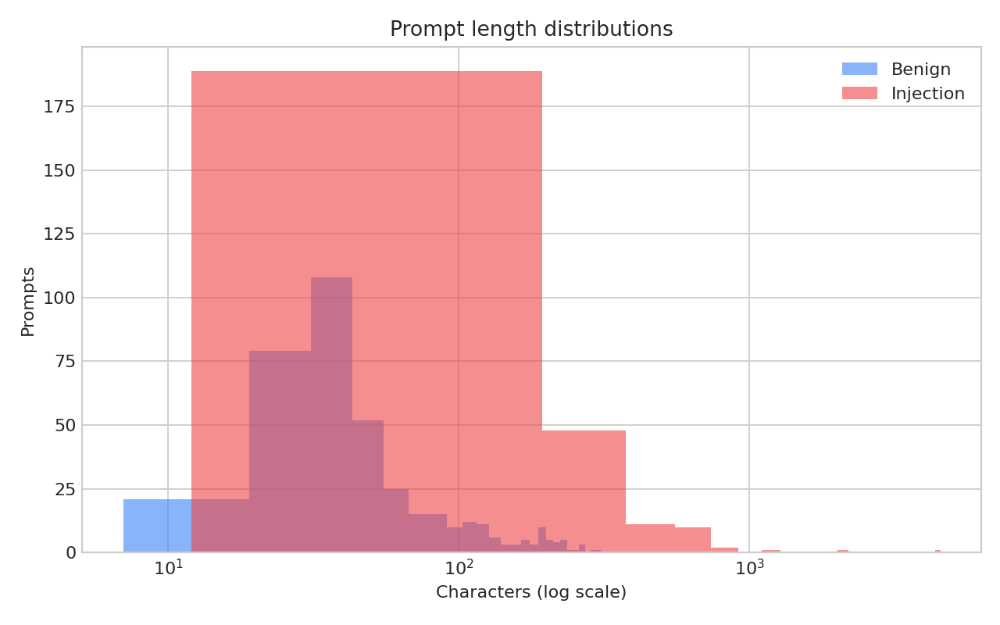
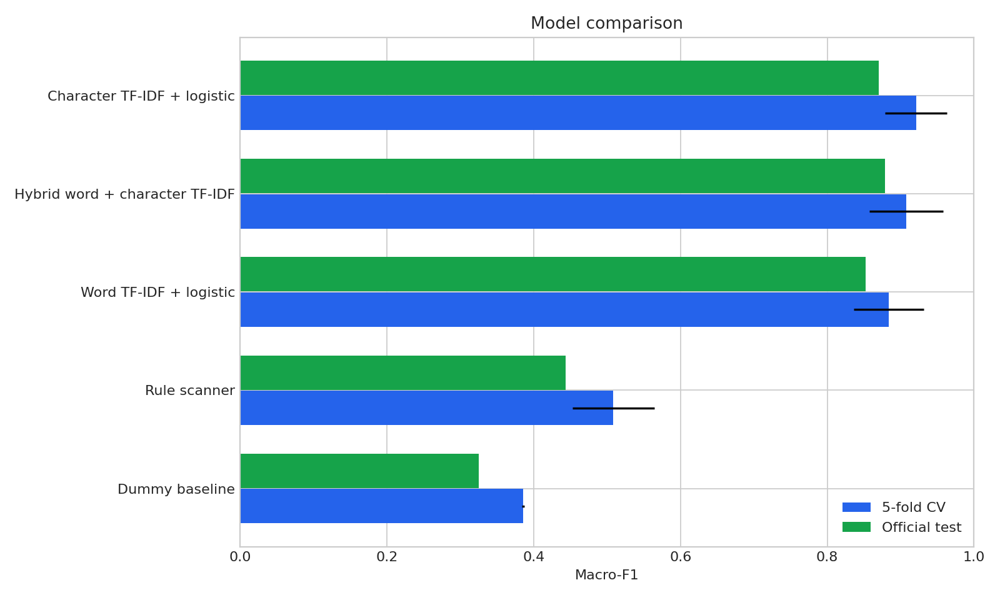
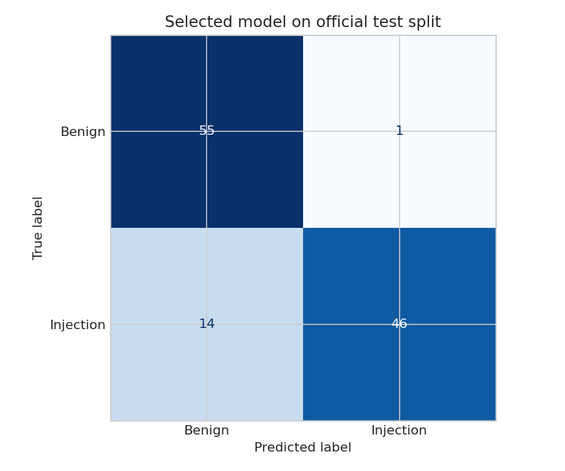
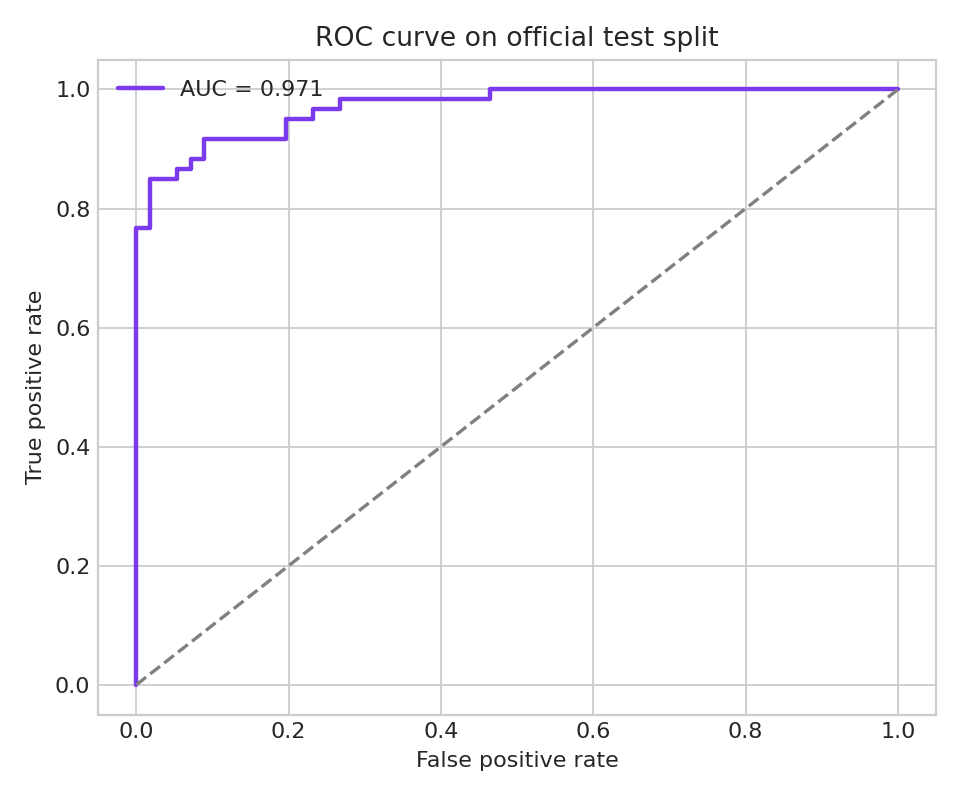
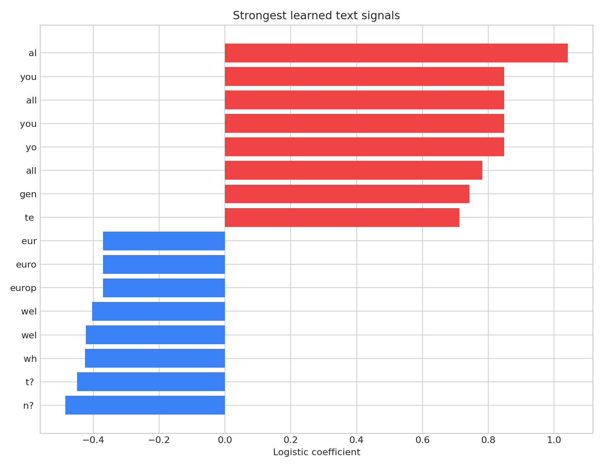

# كشف حقن التعليمات في تطبيقات النماذج اللغوية

أداة محلية لتصنيف النصوص ورصد محاولات حقن التعليمات قبل وصول المحتوى غير الموثوق إلى النموذج اللغوي.

تضم المجموعة 662 نصًا. اختير تمثيل TF-IDF للمحارف مع الانحدار اللوجستي على بيانات التدريب، ثم قُيّم على 116 عينة محفوظة.

سُجلت 15 حالة خطأ: إيجابية كاذبة واحدة و14 سلبية كاذبة. فاصل الثقة التقريبي لمقياس F1 الكلي هو [0.8045, 0.9300]، مشروط بالنموذج الثابت.

المجموعة صغيرة وتتضمن عبارات هجوم يمكن تمييزها. قد تتجاوزها هجمات جديدة أو مموهة أو متعددة اللغات أو غير مباشرة. تستخدم الأداة طبقةً مساعدة ضمن دفاع متعدد الطبقات، ولا توفر ضمانًا أمنيًا.

## النتائج المسجّلة

الأرقام التالية من التنفيذ المحفوظ لهذه النسخة؛ لم تُعَد التجارب أثناء تعريب التوثيق.

### التحقق المتقاطع على التدريب

| النموذج | Macro-F1 | الانحراف المعياري بين الطيات |
| :--- | :--- | :--- |
| **TF-IDF للمحارف مع انحدار لوجستي** | **0.9212** | 0.0422 |
| TF-IDF يجمع الكلمات والمحارف | 0.9074 | 0.0503 |
| TF-IDF للكلمات مع انحدار لوجستي | 0.8837 | 0.0477 |
| ماسح القواعد | 0.5087 | 0.0556 |
| خط الأساس البسيط | 0.3858 | 0.0017 |

### التقييم النهائي على الاختبار المحفوظ (116 عينة)

| النموذج | Macro-F1 | ROC-AUC | استدعاء محاولات الحقن |
| :--- | :--- | :--- | :--- |
| **TF-IDF للمحارف مع انحدار لوجستي** | **0.8699** | **0.9708** | **0.7667** |
| خط الأساس البسيط | 0.3256 | 0.5000 | 0.0000 |

## الرسوم والنتائج المرئية

الرسوم محفوظة من التنفيذ الأصلي. تعريب هذه الصفحة لا يغيّر بياناتها أو تسميات الصور داخل الملفات.

## الملفات المرجعية

- [مقاييس التقييم والنتائج](metrics.json).
- [بيانات التدقيق وبيئة التنفيذ](audit.json).
- [مصدر البيانات وشروط الترخيص](SOURCE.md).
- [سجل أخطاء الاختبار](error_analysis.csv).
- [دفتر شرح التحليل](analysis.ipynb).
- [ملاحظات المراجعة البشرية](LEARNING_NOTES.md).

## المصادر والإسناد

- [مصدر 1: deepset Prompt Injections](https://huggingface.co/datasets/deepset/prompt-injections).

[المرجع التقني الإنجليزي الكامل](README.en.md) يحفظ تفاصيل النسخة الأصلية. تُترك أسماء الملفات والأوامر ومعرّفات النماذج والمقاييس بصيغتها التقنية لضمان تطابقها مع الكود.
